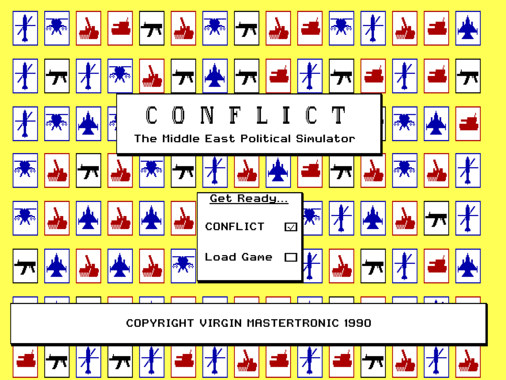
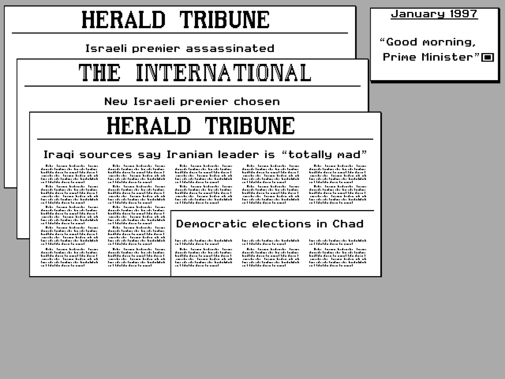
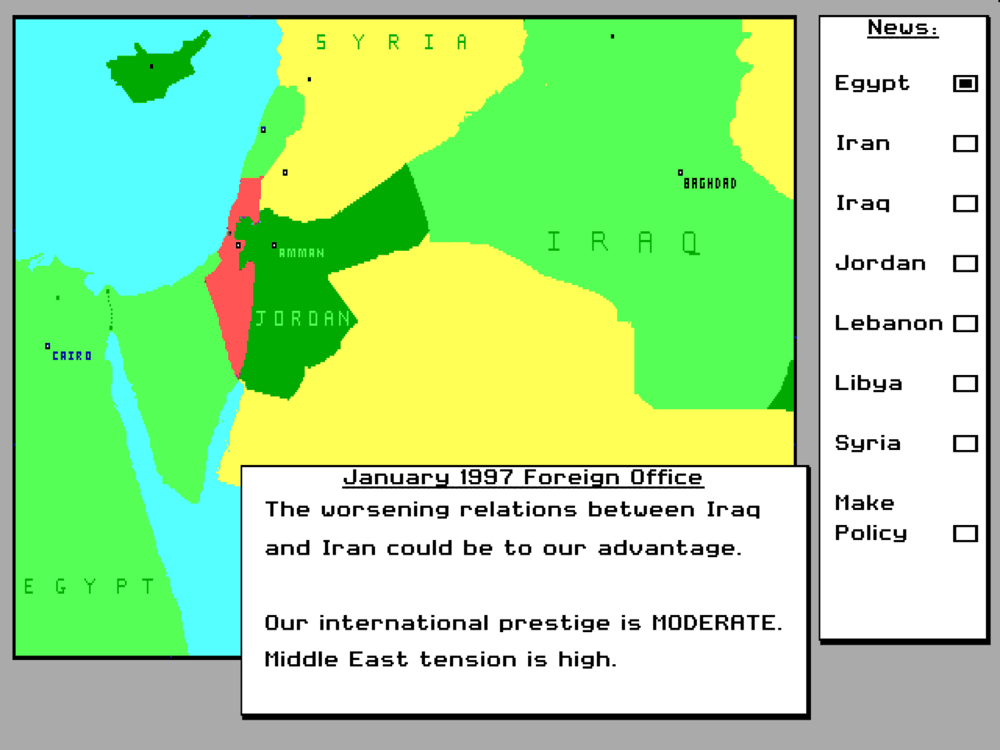
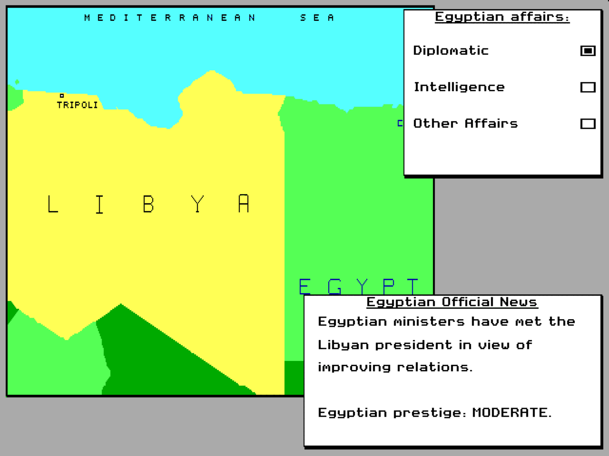

# Conflict: Middle East Political Simulator — C++ port

A C++ port of the 1990 MS-DOS game: a readable reimplementation derived by
disassembly/decompilation, using SDL3 for graphics and input. It runs on **Windows** and **Linux**,
with ready-made downloads for both on the
[Releases page](https://github.com/s-papanastasiou/conflict-port/releases/latest).

**Status:** all 119 game functions are ported and match the original in differential tests; the
game is playable from the intro to the end-of-game analysis.

The original game files are **not** included: you download them yourself from the Internet Archive
(free, a few minutes) — see the steps for [Windows](#how-to-play-on-windows-step-by-step) or
[Linux](#how-to-play-on-linux-step-by-step).

<table>
<tr>
<td align="center"> Title screen</td>
<td align="center"> The monthly newspaper</td>
</tr>
<tr>
<td align="center"> The Foreign Office briefing</td>
<td align="center"> Dealing with a neighbour: Egypt</td>
</tr>
</table>

*Screenshots of this port running with the original game files.*

## How to play on Linux (step by step)

### The quick way: download the ready-made version
Runs on 64-bit Linux distributions from about 2022 on (Ubuntu 22.04+, Debian 12+, Linux Mint 21+,
Fedora, Arch, …); nothing needs to be installed. In a terminal:

    curl -L https://github.com/s-papanastasiou/conflict-port/releases/latest/download/conflict-linux-x86_64.tar.gz | tar xz
    cd conflict-port
    curl -L -o conflict.zip https://archive.org/download/conflict_201509/conflict.zip
    unzip conflict.zip -x '__MACOSX/*'
    ./conflict-port

The first line downloads the game from this project's
[Releases page](https://github.com/s-papanastasiou/conflict-port/releases/latest) into a folder
`conflict-port`; the next two get the original game files from the Internet Archive into
`conflict-port/conflict`. Next time just run `./conflict-port` in that folder (or double-click
it). `HOW-TO-PLAY.txt` in the folder repeats these steps.

### Building it yourself
You need a terminal. Copy each command into the terminal and press Enter.

**1. Install the tools to build the game** (a C++ compiler, CMake, SDL3 and unzip):

| Distribution | Command |
|---|---|
| Fedora | `sudo dnf install gcc-c++ cmake SDL3-devel unzip curl git` |
| Ubuntu 25.04+ / Debian 13+ | `sudo apt install g++ cmake libsdl3-dev unzip curl git` |
| Arch / Manjaro | `sudo pacman -S gcc cmake sdl3 unzip curl git` |

Older distributions may not have SDL3 yet; then it has to be built from <https://github.com/libsdl-org/SDL>.

**2. Download this port:**

    git clone https://github.com/s-papanastasiou/conflict-port.git
    cd conflict-port

(Or use GitHub's green **Code** button → **Download ZIP** and unpack it. The folder it creates is
called `conflict-port-main`; rename it to `conflict-port` and open a terminal in it.)

**3. Get the original game files from the Internet Archive.** Still in the `conflict-port`
folder, run:

    curl -L -o conflict.zip https://archive.org/download/conflict_201509/conflict.zip
    unzip conflict.zip -x '__MACOSX/*'

This creates a folder `conflict` inside `conflict-port` containing `Conflict.exe` and the
game's `.DAT`, `.MP`, `.FNT` and `.SAV` files. Afterwards you can delete `conflict.zip`.

*Without the terminal:* open <https://archive.org/download/conflict_201509/conflict.zip> in your
browser to download `conflict.zip` (it is the file listed on the game's page
<https://archive.org/details/conflict_201509> under **Download options → SHOW ALL**). Unpack it and
move the `conflict` folder it contains into the `conflict-port` folder. If your unpacker also
creates a `__MACOSX` folder, delete it; it is not needed.

The folders must end up like this:

    conflict-port/
    ├── run.sh
    ├── src/ ...
    └── conflict/
        ├── Conflict.exe
        ├── ISRAEL.MP
        └── ... (the other game files)

**4. Start the game:**

    ./run.sh

The first start builds the game, which takes a minute; after that it starts at once. You can also
double-click `run.sh` in a file manager. If the game files are missing, the game says where they go.

The manual is worth reading — the game makes much more sense with it. It is on the same Internet
Archive page (`ConflictManual.pdf`). For the exact rules behind it, see
[How CONFLICT works](docs/HOW_THE_GAME_WORKS.md). See [Playing](#playing) for the keys.

## How to play on Windows (step by step)
Nothing needs to be installed or built.

**1. Download the game:** on this project's
[Releases page](https://github.com/s-papanastasiou/conflict-port/releases/latest) download
`conflict-windows.zip`. Right-click it → **Extract All…**. This gives a folder `conflict-port`
with `conflict.exe`, `SDL3.dll` and `HOW-TO-PLAY.txt`.

**2. Get the original game files:** download
<https://archive.org/download/conflict_201509/conflict.zip> from the Internet Archive and extract
it the same way. It contains a folder called `conflict`: move that folder into `conflict-port`,
next to `conflict.exe`. (If there is also a `__MACOSX` folder, ignore it.) It must look like this:

    conflict-port\
    ├── conflict.exe
    ├── SDL3.dll
    ├── HOW-TO-PLAY.txt
    └── conflict\
        ├── Conflict.exe
        ├── ISRAEL.MP
        └── ... (the other game files)

**3. Double-click `conflict.exe`.** Windows may warn "Windows protected your PC", because the
program is not signed by a known publisher: click **More info**, then **Run anyway**. If the
game files are not in the right place, the game says where they go.

## The original game
*Conflict: Middle East Political Simulator* was designed and written by David J. Eastman, developed
by PSI Software and published by Virgin Mastertronic in 1990 for MS-DOS, Atari ST and Amiga.
Shahid Ahmad wrote the small graphics library the game uses (the hand-written EGA driver this
port reimplements in `src/platform/ega.cpp`) and guided Eastman towards C.

- Wikipedia: <https://en.wikipedia.org/wiki/Conflict%3A_Middle_East_Political_Simulator>
- Internet Archive (the MS-DOS version this port was made from):
  <https://archive.org/details/conflict_201509>
- The designer's own page about the game (archived copy from January 2022):
  <https://web.archive.org/web/20220116190613/http://www.eastman.me.uk/conflict.htm>

### Original files and permission
The game is no longer sold. On his page about the game, David J. Eastman writes (his site is no
longer online; the page is preserved by the Wayback Machine at
<https://web.archive.org/web/20220116190613/http://www.eastman.me.uk/conflict.htm>):

> The PC version can be downloaded from abandonware sites.

and, answering "What about open source development":

> I'm perfectly happy about open source development based on Conflict. You can contact me first,
> or just go and do it. Just follow the usual etiquette.

Wikipedia likewise notes that he "has encouraged players to download the PC version from
'abandonware' sites". The Internet Archive copy above is distributed on that basis.

This port is made in that spirit, following the usual etiquette: the original author and
contributors are credited, the original game is linked, and the port's purpose is to keep the game
playable. It relies on the author's encouragement for using the original game files, and to
respect it this repository contains **no original game data** — no executable, data files,
graphics, maps or fonts. Two exceptions, for readability and illustration only: the game's texts
are **quoted in code comments** next to the code that uses them (often shortened), so the code can
be read without the game files, together with a few messages quoted in the bug notes; and four
screenshots of the port in `docs/screenshots/` show what the game looks like. The program itself
contains none of it: at start-up the port reads everything it needs (texts, tables, maps,
pictures, fonts) from your own copy of the original game, for example the one from the Internet Archive. Copyright in the original game
remains with its owners; if the author or rights holder objects to this use, the port will be
changed or withdrawn.

### The crash the author mentions
Eastman's page (same Wayback Machine link as above) also answers "Is there a fix for the crash bug?":

> There does seem to be a bug which crashed the game depending on how things develop.
> Unfortunately I know of no way around this and I don't have the code.

Reconstructing the code made it possible to find the original's memory-corruption bugs — a stack
buffer overflow in the text windows and writes outside the front-line display at the end of a war
(bugs #1 and #23 in [docs/ORIGINAL_BUGS.md](docs/ORIGINAL_BUGS.md)), both depending on how the game
develops — and to fix them, together with the other bugs listed below. Whether these are the crash
players reported cannot be confirmed, but they are the kind of fault that matches the description.

## Redrawn maps
Before the game starts, a launcher asks which maps to use: **Original** (the 1990 maps, the
default) or **Redrawn** — new versions of all five maps with real coastlines and borders, thin
border lines, a ripple along the coasts and city names, in the game's 16 colours. Use the arrow
keys and Enter; Esc quits. `--maps original` or `--maps redrawn` skips the launcher.

The redrawn maps keep the original layout: every country is where the original puts it and has
its original colour, because the game draws war, collapse and brigade markers at fixed positions
on the maps and recolours collapsed countries by colour. They are drawn by
`tools/redraw_maps.py` from [Natural Earth](https://www.naturalearthdata.com/) data (public
domain), projected to match the original maps, with labels in DejaVu Sans Condensed (free licence);
the result is in `assets/maps/` and built into the program. No original game data goes into
them. To redraw them (needs Python 3 with numpy and Pillow; Natural Earth is downloaded on first
use): `python3 tools/redraw_maps.py`.

## Repository layout
- `re/` — reverse-engineering notes, symbol map, checksums of the reference files
- `tools/` — Ghidra headless pipeline (`ghidra_rebuild.sh`), disassembler helper, save decoder,
  release packaging (`package-windows.sh`, `package-linux.sh`), map drawing (`redraw_maps.py`)
- `assets/maps/` — the redrawn maps (`.MP`, the original map format), embedded at build time by
  `cmake/embed_maps.cmake`
- `src/platform/` — SDL3 host, EGA driver model (640x350, front + back buffer in modelled VRAM),
  file and asset loading, the start-up launcher
- `src/game/` — the game: DGROUP model (`dgroup`, `globals`), C runtime replacements (`crt`),
  driver bridge (`sys`), menus and windows (`ui`), start-up and title (`startup`), save/load (`save`),
  the neighbours' AI (`ai`), monthly bookkeeping (`monthly`), the newspaper, Foreign Office
  (`affairs`, `diplomacy`), the Prime Minister's month (`month`), arms market (`arms`), border
  command (`border`), policies (`policy`), wars and strikes (`war`), yearly events (`yearly`),
  game over (`endgame`), reports (`reports`)
- `src/tools/viewer.cpp` — asset/driver test viewer
- `docs/HOW_THE_GAME_WORKS.md` — the game's rules as the code implements them (thresholds,
  what the neighbours do, wars, the US, arms, scoring)
- `docs/ORIGINAL_BUGS.md` — bugs found in the original game and how they are fixed
- `tests/` — core checks (RNG sequence, save files round-trip byte for byte), redrawn-map checks
  and `difftest`
- `tools/oracle.py`, `tools/difftest.py` — differential testing: run an original function in an
  x86 emulator (Unicorn) and the ported one on the same state, compare memory byte for byte

## How the port is built
The original keeps all data in one 64 KB segment and addresses it by 16-bit offsets (saved games
even contain such offsets). The port keeps that segment as real memory, **loaded at start-up from
your own CONFLICT.EXE**, and the C++ code reaches it through named, typed views. So no original
text or tables are compiled into the port, behaviour stays identical, and save files are
interchangeable with the DOS version.

## Bugs fixed from the original
The port found 24 bugs in the 1990 game (full details, with addresses, in
[docs/ORIGINAL_BUGS.md](docs/ORIGINAL_BUGS.md)). They are fixed by default; run
`conflict --original-bugs` to play with the original behaviour.

- **Crashes / memory corruption:** the summit's "war duration" text could overflow a stack buffer
  (#1); the front-line bar was written outside its string at the end of a war (#23); a one-byte
  heap overflow when loading fonts (#8).
- **War engine:** a battle counter not reset between pairs of nations made unrelated hostile
  borders count as battles — even ending the game with Israel "overrun" (#3); Egypt and Syria
  always threw their whole army at the front instead of the intended share (#18); Israel's
  gunships fought in other nations' wars (#19); large SAM forces stopped working because of a
  16-bit overflow (#22); air strikes destroyed extra bombers (#21).
- **Nuclear programmes:** striking a young programme made its level negative and froze it, with an
  error printed every month (#20).
- **Orders:** posting a brigade put its SAMs in the light-tank count (#2); supporting a maxed-out
  insurgency still cost money (#16); a failed assassination attempt improved relations with the
  US instead of harming them (#24).
- **AI:** uninitialised values in the neighbours' monthly decisions (#5).
- **Interface:** Enter could not skip pauses and arrow keys waited for a second key (#7); text
  centring measured the last letter wrongly (#6); some news items were missing from a nation's
  "Official News" (#14); a stale front-line bar after loading (#15); a spelling mistake (#17).
- **Files:** the game looked for its pictures and saves in the parent directory (#9).
- **Latent issues** that the shipped data never triggers were also fixed (#10–#13).

## Playing
Get the original game files into `conflict/` (see [How to play on Linux](#how-to-play-on-linux-step-by-step)),
then run `./run.sh` — or double-click it in a file manager. It builds the game the first time (and
after source changes) and starts it. Options are passed on, e.g. `./run.sh --original-bugs`. On
Windows, double-click `conflict.exe`, or run `conflict.exe --original-bugs` from a command prompt.
The launcher comes first: choose the original or the [redrawn maps](#redrawn-maps), then Enter.

Keys: arrows / Home / End to choose, Enter to confirm, Shift-B briefing, Shift-S save (at the
newspaper), Shift-E quit; **F11** toggles fullscreen.

## Build
Needs CMake ≥ 3.24, a C++20 compiler and SDL3 (3.4+ for pixel-art scaling).

    cmake -S . -B build && cmake --build build
    ./build/conflict-viewer --game conflict              # Left/Right: scenes, Esc: quit
    ./build/conflict-viewer --game conflict --dump shots  # headless: write scene_N.bmp
    ./build/conflict --game conflict                     # the game (bugs fixed); F11: fullscreen
    ./build/conflict --game conflict --original-bugs     # exact 1990 behaviour
    ./build/conflict --game conflict --maps redrawn      # no launcher, redrawn maps
    ./build/conflict --game conflict --headless --keys enter,enter,down,enter --shots out
    #   scripted runs skip the launcher (original maps) unless --launcher is given
    (cd build && ctest)                                   # tests (need the files in conflict/)

Differential testing against the original needs Unicorn in a local virtualenv:

    python3 -m venv .venv && .venv/bin/pip install unicorn
    .venv/bin/python tools/difftest.py --sweep nation_turn          # every save x seeds x nation
    .venv/bin/python tools/difftest.py 'pressure:2,6@conflict/CONF1.SAV#5'

### Windows version
Built on Linux with MinGW-w64 and tested with Wine. Needs the MinGW C++ compiler, SDL3 for MinGW
and `zip` (Fedora: `sudo dnf install mingw64-gcc-c++ mingw64-SDL3 zip`):

    tools/package-windows.sh        # -> dist/conflict-windows.zip (conflict.exe, SDL3.dll, HOW-TO-PLAY.txt)

The C and C++ runtimes are linked into `conflict.exe`, so `SDL3.dll` is the only DLL it needs.
Without `--game` the program looks for the game files in a `conflict` folder next to itself.

### Linux release version
Built in an Ubuntu 22.04 container so that it runs on older distributions too (glibc 2.35+);
needs podman or docker:

    tools/package-linux.sh          # -> dist/conflict-linux-x86_64.tar.gz (conflict-port, libSDL3.so.0, HOW-TO-PLAY.txt)

SDL3 is built from source in the container and shipped next to the program (found through
`$ORIGIN`); the C++ runtime is linked in (`-DCONFLICT_PORTABLE=ON`). The program is called
`conflict-port` there, because `conflict` is the name of the game-files folder beside it.

Rebuild the Ghidra analysis: `tools/ghidra_rebuild.sh` (needs the Ghidra flatpak).
